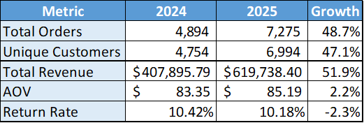
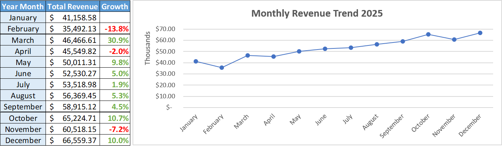
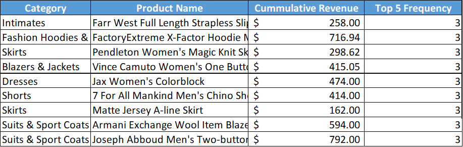
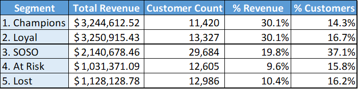

# E-Commerce Performance Analysis: Customer Behavior & Revenue Optimization

## Overview
This project analyzes transactional data from a public e-commerce dataset to uncover actionable business insights across revenue performance, product behavior, and customer segmentation.

**Dataset:** [TheLook E-Commerce](https://console.cloud.google.com/marketplace/product/bigquery-public-data/thelook-ecommerce) (Google BigQuery Public Dataset)  
**Tools:** Google BigQuery (SQL), Microsoft Excel (Visualization)  
**Scope:** 2024–2025 transactional data
**Note:** Query results may vary over time as TheLook E-commerce is a live-updated dataset. All insights below were pulled on Oct 16, 2026.

## Business Questions
1. How did overall business performance change year-over-year?
2. What does monthly revenue trend reveal about growth patterns and risk?
3. Which products consistently drive revenue, and which categories lack a hero product?
4. How are customers segmented by behavior, and where are the biggest growth and retention opportunities?

## Deliverables

### 1. KPI Summary (2024 vs 2025)
📄 [View Query](queries.sql)

**Insight:** Revenue grew 52% YoY — outpacing customer growth of 47% — driven by a 2.2% increase in Average Order Value (AOV), indicating each customer is contributing more value per transaction.

**So What:** The business is growing efficiently. Not only acquiring more customers, but gaining more revenue from each cust. Furthermore, the return rate is declining by -2.3%, indicating the product fit the market. The company needs to shift the focus toward **retention over acquisition** since customers already spend more and returning less.

### 2. Monthly Revenue Trend with MoM Growth (2025)
📄 [View Query](queries.sql)

**Insight:** Revenue followed an overall upward trend in 2025, growing from $41.16K in January to $66.56K in December. In March, the revenue spiking up to 30% likely event-driven growth. However, two dips occurred in February and November, and a consistent increasing observed from March – October before a sharp declining in November by **-7.2%**.

**So What:** The marketing team should investigate root causes of the two dip months, whether driven by seasonality, campaign gaps, or external factors. Besides, the marketing team needs to find out any occurrences happened in March and then replicate the strategy to create the similar spike.

---

### 3. Top 5 Products by Revenue per Category (2025)
📄 [View Query](queries.sql)

**Insight:** No single product consistently appeared in the top 5 within its category for 6 or more months in 2025, suggesting high revenue volatility at the product level. No clear "hero product" exists across categories.

**So What:** This indicates customers are not strongly attached to specific products, pointing to **low product loyalty** and potentially price or novelty-driven purchasing behavior. Without a stable hero product, the business is exposed to unpredictable revenue swings. The product team should investigate whether this pattern stems from stockout issues, weak product differentiation, or lack of loyalty incentives. And consider developing a **hero product strategy** per category to build more predictable revenue streams.

---

### 4. RFM Customer Segmentation
📄 [View Query](queries.sql)

**Insight:** The top 2 segments — Champions and Loyal — represent only 31% of users but contribute 60% of total revenue, confirming a Pareto-like revenue concentration. Critically, At Risk and Lost customers combined represent 32% of the user base and have already disengaged, while the SOSO segment (37% of users, 20% revenue) sits in a vulnerable middle ground with low purchasing commitment.

**So What:** The business has to prioritize these two things: 1. Protect the revenue base; 2. Recover churning customers. For Champions and Loyal, implement retention programs such as early product access and exclusive loyalty tiers to prevent downgrade. For At Risk customers, deploy **win-back campaigns** with personalized offers before they fully churn. The SOSO segment represents the biggest **untapped growth opportunity**. Targeted engagement campaigns that migrate even 20% of them into Loyal could meaningfully grow revenue without acquiring new customers.

---

## Key Takeaways
- Business is growing efficiently — revenue outpaces customer growth, driven by higher spend per customer
- Growth is partially event-driven, creating vulnerability during non-promotional periods
- No hero product exists across categories, signaling low product loyalty
- 60% of revenue is concentrated in 31% of customers — retention is more critical than acquisition
